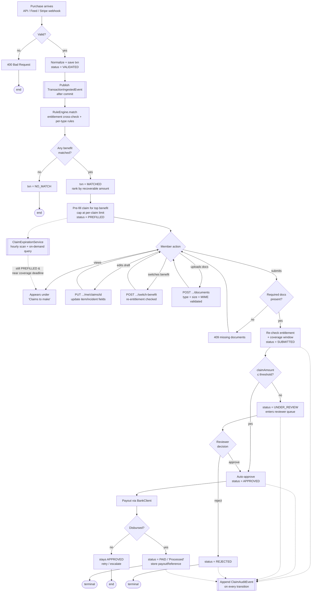
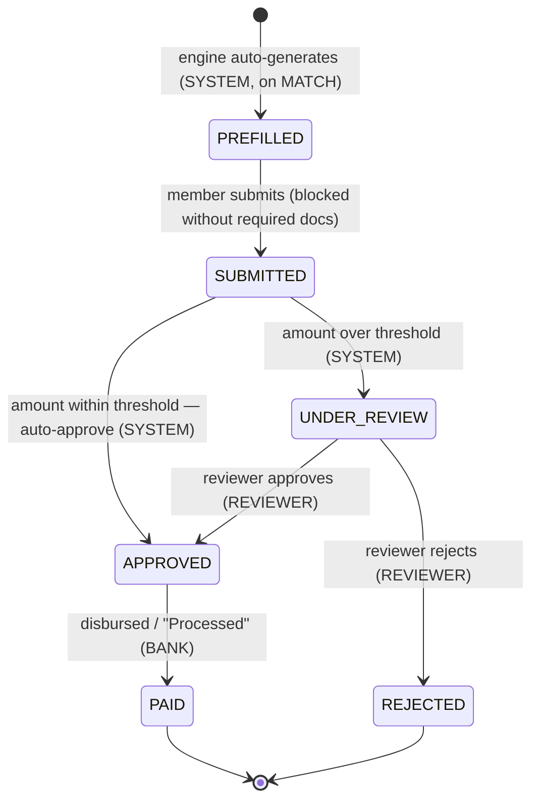
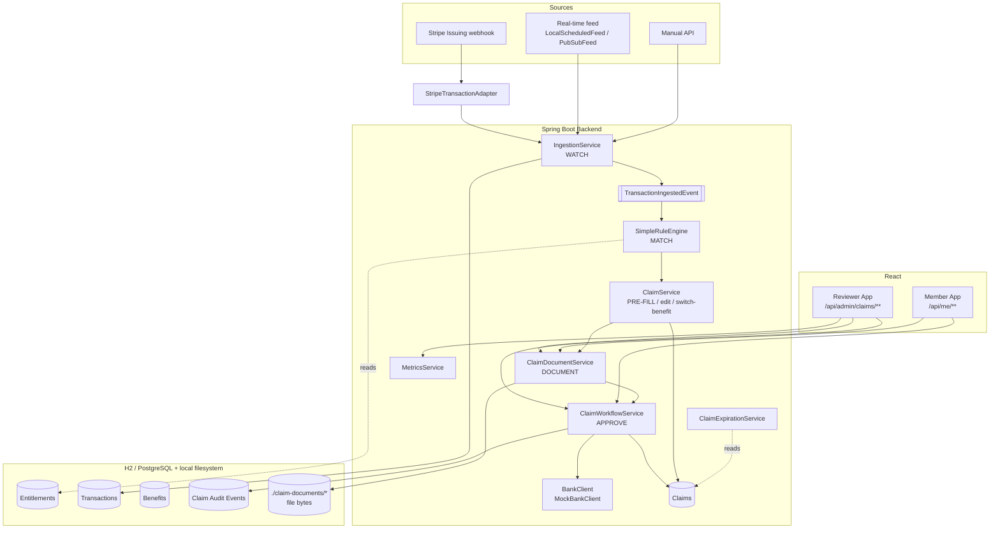

# Benovra - Card Benefit Activation Engine

> **Never leave a benefit you've paid for unclaimed.**

Most card members are unaware of — or simply forget to claim — the insurance and protection
benefits already built into their credit cards. Purchase protection, return protection, and
travel-delay insurance quietly go unused, so people leave real money on the table.

The **Card Benefit Activation Engine** closes that gap. It **watches** every purchase,
**matches** it to the right protection benefit, **pre-fills** a ready-to-submit claim, collects
the **supporting documents** each benefit actually requires, and drives the claim through a full
submission and **approval** workflow — so a card member reviews, attaches evidence, and taps
*Submit*.

*· Spring Boot 4.1.0 (Java 21) + React 18*

---

## Table of Contents

1. [Why This Matters](#why-this-matters)
2. [How It Works](#how-it-works)
3. [End-to-End Flow](#end-to-end-flow)
4. [Feature Tour](#feature-tour)
5. [Tech Stack](#tech-stack)
6. [Architecture](#architecture)
7. [Running the Project](#running-the-project)
8. [API Reference](#api-reference)
9. [Security Model](#security-model)
10. [Configuration](#configuration)
11. [Seed Data](#seed-data)
12. [Testing](#testing)
13. [Design Decisions](#design-decisions)
14. [What's Real vs. Simulated](#whats-real-vs-simulated)
15. [Project Layout](#project-layout)

---

## Why This Matters

Think of a credit card as a backpack with hidden "magic pockets" most people never open:

| Benefit | What it does                                                                            |
|---------|-----------------------------------------------------------------------------------------|
| 🛡️ **Purchase Protection** | Claims protection over an eligible purchase that is damaged or stolen.                  |
| 📦 **Return Protection** | Claims return protection over an eligible item when a merchant refuses a valid return. |
| ✈️ **Travel-Delay Insurance** | Covers expenses when covered travel is delayed beyond a threshold.                      |

**The problem:** members don't know these pockets exist, so the value sits unused — and issuers
struggle to prove ROI on benefits that are never claimed.

**The value:** members recover money they've already paid for, perceived card value rises, and
engagement and retention improve.

> This is **not** a rewards or loyalty program. The focus is entirely on the *unused insurance
> and protection* side of card benefits.

---

## How It Works

```
WATCH 👀  →  MATCH 🔍  →  PRE-FILL 📝  →  DOCUMENT 📎  →  APPROVE 🏦
```

1. **WATCH** — Ingest and validate every incoming purchase (manual API, real-time feed, or
   Stripe webhook — all through one funnel).
2. **MATCH** — Cross-check the card's entitlements and apply per-benefit rules to decide which
   protection (if any) covers the purchase.
3. **PRE-FILL** — Auto-build a `PREFILLED` claim with every field populated from the transaction.
   The member can edit the draft or switch it to a different benefit the purchase also qualifies
   for before submitting.
4. **DOCUMENT** — Each benefit type has its own required-evidence checklist (receipt, proof of
   loss, return denial, delay certificate, ...). A claim cannot be submitted until its required
   documents are attached.
5. **APPROVE** — Run the claim through an enforced state machine: submit (blocked if documents
   are missing or coverage has expired) → auto-approve or route to a reviewer → disburse, with an
   immutable audit trail at every step. Claims nearing their coverage deadline are surfaced
   proactively so members don't lose the window by accident.

---

## End-to-End Flow



### Claim lifecycle (state machine)



---

## Feature Tour

### 👀 WATCH — Ingestion (`IngestionService`)
- **Single ingestion funnel:** manual REST calls, the scheduled feed, and the Stripe webhook all
  converge on `IngestionService.ingest(...)`, so behavior is identical regardless of source.
- **Webhook authentication:** `/api/stripe/webhook` validates Stripe's timestamped HMAC signature
  against `STRIPE_WEBHOOK_SECRET` and rejects missing, invalid, or older-than-five-minute signatures.
- **Validation + normalization** on every purchase (e.g. card-product casing) before it's saved
  as `VALIDATED`.
- **Event-driven detection:** ingestion publishes a `TransactionIngestedEvent`; matching runs on
  `@TransactionalEventListener(AFTER_COMMIT)` in a fresh transaction — a thin write path and a
  seam ready for a real message broker.

### 🔍 MATCH — Rule Engine (`SimpleRuleEngine` behind `RuleEngine`)
- **Entitlement-first:** only benefits the card product actually holds can ever match.
- **Per-benefit rules:** category + coverage-window checks for purchase/return protection; an
  event-based rule for travel-delay (no days-from-purchase window).
- **Ranking:** matches are ordered by estimated recoverable amount — `min(amount, perClaimLimit)`
  — so the most valuable benefit is offered first.
- **Handles no-match and multiple-match** cleanly. Qualifying categories are **externalized to
  `application.yml`** and editable with zero code changes.
- **Explains `NO_MATCH`:** transaction records distinguish missing data, unavailable entitlements,
  unsupported merchant category, and expired coverage; API responses expose `matchReason`.

### 📝 PRE-FILL — Claim Generation & Editing (`ClaimService`)
- Builds a `Claim` auto-populated from the transaction + matched benefit, saved as `PREFILLED`.
- **Idempotent per `(transaction, benefit)`** — replays and retries never create duplicate claims.
- Claim amount is **capped at the per-claim limit**; pre-fill completeness is verified.
- **Editable drafts:** `PUT /api/me/claims/{id}` lets the member correct the item description,
  incident date, and incident explanation before submitting — ownership-checked (403 if not
  theirs).
- **Switch benefit:** if a purchase qualifies under more than one benefit, `POST
  /api/me/claims/{id}/switch-benefit` moves the draft claim to the alternative (re-checks
  entitlement; 409 if the new benefit isn't held).

### 📎 DOCUMENTS — Supporting Evidence (`ClaimDocumentService`)
- **Per-benefit checklist:** each `BenefitType` defines required and optional document types
  (e.g. Purchase Protection needs a `PURCHASE_RECEIPT` and `PROOF_OF_LOSS`; Travel-Delay needs an
  `AIRLINE_BOOKING_PROOF` and `AIRLINE_DELAY_CERTIFICATE`). `GET .../documents/checklist` returns
  every allowed type for the claim's benefit with its required/uploaded state.
- **Upload validation:** rejects document types that don't belong to the claim's benefit, MIME
  types outside `pdf/png/jpeg/webp/gif`, and files over the configured size cap.
- **Stored on a local filesystem-backed mock store** (`./claim-documents/{claimId}/...` by
  default) behind `ClaimDocumentService` — a clean seam for swapping in S3 or equivalent object
  storage.
- **Submission gate:** `ClaimWorkflowService.submit(...)` calls
  `assertRequiredDocumentsPresent(...)` — a claim cannot move to `SUBMITTED` while any required
  document type is missing.
- **Reviewer visibility:** the admin API exposes the same list/download endpoints (read-only) so
  a reviewer can inspect evidence before deciding.

### ⏳ EXPIRATION TRACKING (`ClaimExpirationService`)
- **On-demand:** `GET /api/me/claims/expiring?withinDays=7` and
  `GET /api/admin/claims/expiring?withinDays=7` return still-`PREFILLED` claims whose coverage
  window closes within the given number of days, soonest first.
- **Background scan:** a `@Scheduled` sweep (interval configurable, default hourly) logs any
  claims entering the warning window so drafts don't silently expire unclaimed.

### 🏦 APPROVE — Workflow (`ClaimWorkflowService`)
- **Enforced state machine:** legal transitions are declared on the `ClaimStatus` enum; illegal
  moves throw and return **409**, making invalid states unrepresentable via the API.
- **Auto-decision:** claims at or below the configured threshold auto-approve on submit; larger
  ones route to manual review.
- **Entitlement re-checked on submit** — a revoked benefit throws `ClaimNotEntitled` (409).
- **Coverage window re-checked on submit** — expired purchase/return claims remain unsubmitted and
  return 409; travel-delay claims remain event-based.
- **Documents re-checked on submit** — see the DOCUMENTS section above.
- **Payout** delegates to a `BankClient` interface (`MockBankClient` in the prototype) and moves
  the claim to `PAID` with a payout reference.
- **Append-only audit trail:** every transition records who / what / why (`SYSTEM`, `REVIEWER`,
  `BANK`).

### 🔒 BOLA-hardened security (`SecurityConfig`)
- Stateless JWT auth with a **tiered access model**: public (benefits/entitlements/webhooks),
  any-authenticated-user (view/submit your own claim), `CARD_MEMBER`-only (`/api/me/**`), and
  `REVIEWER`-only (`/api/admin/claims/**`, cross-member claim list, audit trail, decisions, full
  transaction list). See the Security Model section below for the full tier breakdown.
- Ownership (BOLA) checks live in the controllers in addition to role checks, so a card member
  with a valid token still can't read or submit another member's claim.

### 📊 METRICS (`MetricsService`)
- `GET /api/metrics` reports purchases ingested, matched, **detection rate %**, total detectable
  value, claimed value, processed/paid value, still-unclaimed value, the headline **% reduction in
  unclaimed benefits**, and a **per-benefit-type utilization breakdown** (eligible / claimed / paid
  claim counts, utilization %, and the corresponding dollar values for each of Purchase
  Protection, Return Protection, and Travel-Delay).

### 🖥️ Two React UIs, one JWT-secured API
- **Member app** — "Claims to make" (pre-filled) vs. "Submitted claims" with live status tracking,
  a claim-review wizard for editing drafts, switching benefits, and uploading the document
  checklist, plus a one-tap submit once everything required is attached.
- **Reviewer app** — review queue (approve/reject with a reason), multi-filter search across all
  customers, document inspection per claim, and a live metrics dashboard.

---

## Tech Stack

| Layer | Technology |
|-------|------------|
| Runtime | **Spring Boot 4.1.0** on **Java 21** |
| Web / API | Spring Web MVC (REST), multipart file upload |
| Data access | Spring Data JPA + Hibernate + Flyway |
| Database | H2 in-memory (demo) → PostgreSQL (prod-ready) |
| Validation | Jakarta Bean Validation |
| Security | Spring Security + JWT (`jjwt` 0.12.6), BOLA-hardened authorization tiers |
| Scheduling | Spring `@Scheduled` (demo feed drip + claim-expiration scan) |
| API docs | springdoc OpenAPI / Swagger UI |
| Boilerplate | Lombok |
| Build | Maven (wrapper included) |
| Testing | JUnit 5 + Mockito + Spring Security Test (30 test classes) |
| Frontend | React 18 + Vite 5 |
| Integration resources | Stripe Issuing (data source) · Google Pub/Sub (transport) · AWS Lambda (optional serverless matching) · local filesystem (document store seam) |

---

## Architecture



**Core principle:** every external dependency (data source, transport, bank, document storage,
compute) sits behind an **interface/adapter** — `RuleEngine`, `BankClient`, `TransactionFeed`,
`ClaimDocumentService`'s storage path. The offline demo runs the *real* code path; only the
external endpoints are swapped via configuration.

---

## Running the Project

### Prerequisites
- **JDK 21+**
- **Node.js 18+** (only if you want to develop the frontend separately)

### Option A — One command (backend serves the pre-built UI)

The production frontend build is emitted into `src/main/resources/static`, so the backend serves
both the UI and the API on a single port:

```bash
# Windows
mvnw.cmd spring-boot:run

# macOS / Linux
./mvnw spring-boot:run
```

Then open:

| URL | What |
|-----|------|
| `http://localhost:8080` | React UI (login as a card member, or `admin` for the reviewer) |
| `http://localhost:8080/swagger-ui.html` | Interactive API docs |
| `http://localhost:8080/h2-console` | H2 database console (JDBC URL `jdbc:h2:mem:benefitdb`) |
| `http://localhost:8080/health` | Lightweight liveness probe (custom) |
| `http://localhost:8080/actuator/health` | Actuator health check |

### Option B — Frontend dev server (hot reload)

Run the backend as above, then in a second terminal:

```bash
cd frontend
npm install
npm run dev          # Vite dev server on http://localhost:5173
```

The Vite dev server proxies `/api` calls to `:8080`, so the browser only ever talks to one origin
(no CORS setup needed).

To rebuild the UI into the backend's static folder:

```bash
cd frontend
npm run build        # outputs to ../src/main/resources/static
```

### Logging in (demo identity)
- Enter **any** card member id (e.g. `CM-1001`) to sign in as a **card member**.
- Enter **`admin`** to sign in as a **reviewer**.

> These are demo identity tokens for the prototype, **not** password-based authentication.

### Trying it out end-to-end

**As a card member (e.g. `CM-1001`):**
- Land on **"Claims to make"** — the pre-filled claims the engine generated for that member's
  matched purchases.
- Open a claim: edit draft fields if needed, switch to an alternative matched benefit if one
  applies, and upload the required documents from the checklist.
- Tap **Submit** — blocked with a clear error until the required documents are attached. Claims
  **at or below $700** are **auto-approved (and paid)** instantly; anything **above $700** is
  routed to a reviewer.
- Track everything under **"Submitted claims"** with its live status, and check **"Expiring
  soon"** so a draft never quietly misses its coverage window.

**As the reviewer (`admin`):**
- Open the **review queue** to see claims **over $700** waiting for a decision.
- Inspect a claim's **uploaded documents** before deciding.
- **Approve** (which disburses the payout) or **Reject** with a reason.
- Use **Search** to filter claims across all customers, and the **Dashboard** for live metrics,
  including the per-benefit utilization breakdown.

### Where the transactions come from

- **Automatic feed (default):** a built-in seeder/feed (`LocalScheduledFeed`) **drips a simulated
  purchase every 5 seconds** the moment the app starts, so matched benefits and pre-filled claims
  appear on their own — no setup needed. Pause it with `POST /api/admin/feed/pause`, resume with
  `POST /api/admin/feed/resume`, or check its state with `GET /api/admin/feed`. Turn it off
  entirely with `feed.type: none` in `application.yml`.
- **Manual entry via Swagger:** open `http://localhost:8080/swagger-ui.html` and use
  **`POST /api/transactions`** to add your own purchase (amount, merchant, category, card product,
  date). It flows through the exact same pipeline — the engine matches it and pre-fills a claim
  that shows up for the matching card member.

---

## API Reference

Base path: `http://localhost:8080`

| Method | Endpoint | Auth | Purpose |
|--------|----------|------|---------|
| `POST` | `/api/auth/login` | public | Issue a JWT (`admin` → reviewer, else card member) |
| `POST` | `/api/transactions` | public | Ingest a purchase (WATCH) |
| `GET`  | `/api/transactions` · `/api/transactions/{id}` | **REVIEWER** | List / view ingested purchases |
| `POST` | `/api/stripe/webhook` | public (HMAC-signed) | Receive Stripe-style authorization events |
| `GET`  | `/api/benefits/{transactionId}` | public | Matched benefits for a purchase (MATCH) |
| `GET`  | `/api/claims` | **REVIEWER** | List every claim across all members |
| `GET`  | `/api/claims/{id}` | authenticated | Get a claim — owner or reviewer only (403 otherwise) |
| `POST` | `/api/claims/{id}/submit` | authenticated | Submit a claim — card members may only submit their own |
| `POST` | `/api/claims/{id}/decision` | **REVIEWER** | Approve / reject a claim |
| `GET`  | `/api/claims/{id}/audit` | **REVIEWER** | Immutable audit trail for a claim |
| `GET`  | `/api/me/claims?status=PREFILLED` | **CARD_MEMBER** | The member's own claims |
| `GET`  | `/api/me/claims/expiring?withinDays=7` | **CARD_MEMBER** | My unsubmitted claims nearing coverage expiry |
| `PUT`  | `/api/me/claims/{id}` | **CARD_MEMBER** | Edit a draft claim's item/incident fields |
| `POST` | `/api/me/claims/{id}/switch-benefit` | **CARD_MEMBER** | Move a draft claim to an alternative matched benefit |
| `POST` | `/api/me/claims/{id}/submit` | **CARD_MEMBER** | Submit one of my pre-filled claims |
| `POST` | `/api/me/claims/{id}/documents` | **CARD_MEMBER** | Upload a supporting document (multipart) |
| `GET`  | `/api/me/claims/{id}/documents` | **CARD_MEMBER** | List my uploaded documents for a claim |
| `GET`  | `/api/me/claims/{id}/documents/checklist` | **CARD_MEMBER** | Required/optional doc types + upload state |
| `GET`  | `/api/me/claims/{id}/documents/{docId}/content` | **CARD_MEMBER** | Download a document's bytes |
| `DELETE` | `/api/me/claims/{id}/documents/{docId}` | **CARD_MEMBER** | Delete an uploaded document |
| `GET`  | `/api/admin/claims` | **REVIEWER** | Search claims across all customers (filters) |
| `GET`  | `/api/admin/claims/expiring?withinDays=7` | **REVIEWER** | Unsubmitted claims nearing coverage expiry (all members) |
| `POST` | `/api/admin/claims/{id}/decision` | **REVIEWER** | Approve / reject a claim |
| `GET`  | `/api/admin/claims/{id}/documents` | **REVIEWER** | List a claim's documents (reviewer inspection) |
| `GET`  | `/api/admin/claims/{id}/documents/{docId}/content` | **REVIEWER** | Download a document's bytes |
| `GET`  | `/api/entitlements` | public | List card entitlements |
| `GET`  | `/api/metrics` | public | Detection rate, unclaimed-reduction, and per-benefit utilization |
| `GET`  | `/api/admin/feed` | public | Demo feed status (`RUNNING` / `PAUSED` / `NOT_ENABLED`) |
| `POST` | `/api/admin/feed/pause` · `/api/admin/feed/resume` | public | Pause / resume the demo feed |
| `GET`  | `/health` | public | Lightweight custom liveness probe |

Protected endpoints expect an `Authorization: Bearer <token>` header. A missing or invalid token
returns **401**; the correct role but wrong ownership returns **403**; a missing required document
or an illegal state transition returns **409**.

---

## Security Model

`SecurityConfig` implements a BOLA-hardened, four-tier access model (stateless JWT, no sessions):

| Tier | Applies to | Notes |
|------|------------|-------|
| **Public** | `/api/auth/**`, `/api/stripe/**`, `/api/admin/feed/**`, `/api/benefits/**`, `/api/entitlements/**`, `POST /api/transactions`, Swagger, H2 console, actuator, static assets | Kept open so the webhook, demo feed, and docs work without a token; the Stripe webhook is instead authenticated by its own HMAC signature. |
| **REVIEWER only** | `/api/admin/claims/**`, `GET /api/transactions/**`, `GET /api/claims`, `GET /api/claims/*/audit`, `POST /api/claims/*/decision` | Cross-member visibility and decision-making are restricted to the reviewer role. |
| **CARD_MEMBER only** | `/api/me/**` | All of a member's own-claims and document endpoints. |
| **Any authenticated user** | `GET /api/claims/{id}`, `POST /api/claims/{id}/submit` | Role alone isn't enough — the controller additionally checks that a `CARD_MEMBER` caller owns the claim before allowing access, returning 403 otherwise. |

This means two independent layers guard a member's data: Spring Security's role-based matcher
chain, and an explicit ownership check inside `ClaimController` / `MeClaimController` /
`ClaimDocumentService` — so a forged or stolen-but-valid token for member A can't be used to read
or act on member B's claims and documents.

---

## Configuration

Key settings in `src/main/resources/application.yml`:

```yaml
feed:
  type: local-scheduled     # local-scheduled | pubsub | none
  local:
    interval-ms: 5000        # emit a simulated purchase every 5s
    initial-delay-ms: 5000
    start-paused: false

matching:                    # which merchant categories qualify each benefit
  categories:
    PURCHASE_PROTECTION: [ELECTRONICS, APPLIANCES]
    RETURN_PROTECTION:   [APPAREL, DEPARTMENT_STORE, ELECTRONICS]
    TRAVEL_DELAY:        [AIRLINE, LODGING, TRAVEL_AGENCY]

workflow:
  auto-approve-threshold: 700.00     # claims at/below this auto-approve; above → manual review
  expiration-warning-days: 7         # "expiring soon" window used by the on-demand queries
  expiration-scan-interval-ms: 3600000   # background scan cadence (default: hourly)

auth:
  jwt:
    secret: ${AUTH_JWT_SECRET:change-me-...}   # override via env in real deployments
    expiry-minutes: ${AUTH_JWT_EXPIRY_MINUTES:120}

stripe:
  webhook:
    secret: ${STRIPE_WEBHOOK_SECRET:}   # required to accept Stripe webhook requests

# Not yet in application.yml (defaults applied in code; add these keys to override):
# app:
#   documents:
#     storage-dir: ./claim-documents        # default
#     max-file-size-bytes: 5242880          # default, 5 MB
```

Flyway applies versioned SQL from `src/main/resources/db/migration` before Hibernate validates
the schema. Hibernate does not create or update tables. The migrations define core tables, foreign
keys, uniqueness constraints, and indexes for member claims, workflow queues, entitlements, audit
events, and claim documents.

Uploaded document bytes are **not** stored in the database — they live under
`app.documents.storage-dir` (default `./claim-documents/{claimId}/...`) on the local filesystem;
only metadata (filename, content type, size, storage key) is persisted via `ClaimDocument`.

---

## Seed Data

`DataSeeder` populates the benefits catalog and entitlements on first startup (idempotent — it
only runs when the benefit table is empty).

**Benefits catalog**

| Benefit | Per-claim limit | Coverage window |
|---------|-----------------|-----------------|
| Purchase Protection | $1,000 | 90 days |
| Return Protection | $300 | 90 days |
| Travel-Delay Insurance | $500 | event-based |

**Entitlements by card product**

| Card | Purchase | Return | Travel-Delay |
|------|:--------:|:------:|:------------:|
| PLATINUM | ✓ | ✓ | ✓ |
| GOLD | ✓ | ✓ | — |
| GREEN | ✓ | — | — |

**Required supporting documents by benefit** (enforced by `ClaimDocumentService`, not seeded —
defined in code as an enum mapping):

| Benefit | Required | Also accepted |
|---------|----------|----------------|
| Purchase Protection | Purchase Receipt, Proof of Loss | Police Report, Other Supporting |
| Return Protection | Purchase Receipt, Merchant Return Denial | Other Supporting |
| Travel-Delay Insurance | Airline Booking Proof, Airline Delay Certificate | Other Supporting |

---

## Testing

Run the full suite:

```bash
./mvnw test        # or mvnw.cmd test on Windows
```

Run frontend tests and production build:

```bash
cd frontend
npm test
npm run build
```

Coverage spans every layer — JUnit 5 + Mockito, **30 test classes**:

- **Engine** — detection accuracy, ranking, coverage windows, and event-driven `NO_MATCH` reasons
  (`SimpleRuleEngineTest`, `BenefitDetectionListenerTest`, `CoverageWindowPolicyTest`).
- **Services** — pre-fill quality (`ClaimServiceTest`), state-machine + illegal-transition
  rejection (`ClaimWorkflowServiceTest`), concurrent-submission safety
  (`ClaimWorkflowConcurrencyTest`), coverage-deadline detection
  (`ClaimExpirationServiceTest`), metrics incl. utilization (`MetricsServiceTest`).
- **Controllers** — per-member scoping (`MeClaimControllerTest`), reviewer queue/search
  (`AdminClaimControllerTest`), generic claims BOLA checks (`ClaimControllerTest`), document
  upload/checklist/download (`ClaimDocumentControllerTest`), feed admin
  (`FeedAdminControllerTest`, `FeedAdminNotEnabledTest`), and a full end-to-end flow
  (`FullClaimFlowIntegrationTest`: ingest → detect → pre-fill → document → submit → approve).
- **Security** — role + ownership enforcement across every tier
  (`SecurityAccessControlIntegrationTest`).
- **Integration** — signed Stripe webhook verification and mapping
  (`StripeWebhookIntegrationTest`, `StripeTransactionAdapterTest`), feed selection and drip
  behavior (`FeedSelectionLocalTest`, `FeedSelectionPubSubTest`, `LocalScheduledFeedTest`), and
  JPA persistence (`DataModelPersistenceTest`).

---

## Design Decisions

- **Event-driven decoupling** keeps the ingestion write path thin and leaves a clean seam for a
  real message broker.
- **Enforced state machine** — legal transitions live on the enum, so invalid states can't be
  reached through the API.
- **Idempotent pre-fill** makes replays and feed re-drips safe.
- **Documents gate submission, not pre-fill** — a claim can be pre-filled and drafted immediately,
  but the workflow service refuses to move it to `SUBMITTED` until its required evidence exists,
  keeping the "fast pre-fill, but no empty claims reach a reviewer" property.
- **Append-only audit log** gives full traceability and also powers the reviewer "Approved"
  filter (actor `REVIEWER` → `APPROVED`).
- **Swappable seams** (`RuleEngine`, `BankClient`, `TransactionFeed`, document storage path) plus
  config-driven rules and thresholds mean production wiring changes configuration, not code.
- **BOLA defense in depth** — role-based route matching in `SecurityConfig` is backed by explicit
  ownership checks inside the controllers/services, so authorization doesn't rest on routing
  alone.

---

## What's Real vs. Simulated

| Capability | Status                                                    |
|------------|-----------------------------------------------------------|
| Transaction ingestion & validation | ✅ Real                                                    |
| Benefit detection / matching | ✅ Real (unit-tested)                                      |
| Claim pre-fill, draft editing, benefit switching | ✅ Real                                                    |
| Supporting-document checklist, upload, and submission gate | ✅ Real (stored on local filesystem, not cloud object storage) |
| Claim expiration tracking | ✅ Real (on-demand + scheduled scan)                       |
| Entitlement management | ✅ Real                                                    |
| Submission + approval state machine + audit | ✅ Real                                                    |
| Metrics incl. per-benefit utilization | ✅ Real                                                    |
| Final approval decision + money movement | ✅ Simulated — requires Bank Access; behind `BankClient`   |
| Stripe live webhook | ✅ Simulated offline — real adapter, sample JSON in demo  |

We build the entire workflow and stop only at the point that physically requires being American
Express (a banking license and regulated payment rails) — documented behind a clean integration
interface.

---

## Project Layout

```
benefit-activation-engine/
├── src/main/java/com/amex/benefit_activation_engine/
│   ├── controller/    REST endpoints (transactions, claims, admin, me, auth, metrics, stripe, health)
│   ├── service/       IngestionService, ClaimService, ClaimWorkflowService, ClaimDocumentService,
│   │                   ClaimExpirationService, MetricsService
│   ├── engine/        RuleEngine + SimpleRuleEngine + BenefitDetectionListener (MATCH)
│   ├── model/         JPA entities + enums (Transaction, Benefit, Entitlement, Claim,
│   │                   ClaimDocument, ClaimDocumentType, ...)
│   ├── repository/    Spring Data JPA repositories
│   ├── integration/   stripe/ · feed/ · bank/ adapters (swappable seams)
│   ├── security/      JWT auth (JwtService, JwtAuthFilter, SecurityConfig, Roles)
│   ├── dto/           request/response payloads
│   └── config/        DataSeeder + SchedulingConfig + config properties (Matching/Workflow)
├── src/test/java/...  JUnit 5 / Mockito test suite (30 test classes)
├── frontend/          React 18 + Vite UI (Member app + Reviewer app, incl. claim-review wizard)
├── claim-documents/   Local filesystem store for uploaded claim evidence (dev/demo default)
├── docs/diagrams/     Architecture & flow diagrams (generated)
└── src/main/resources/application.yml   central configuration
```

This Application is Under Progress, so it needs to be improved at many places
Open for any kind of suggestion/contribution.
